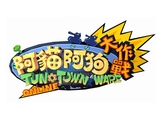
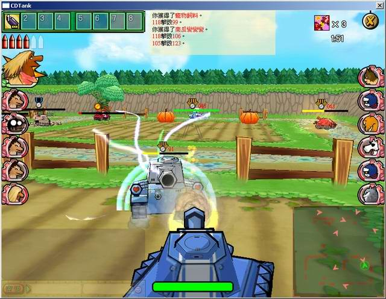
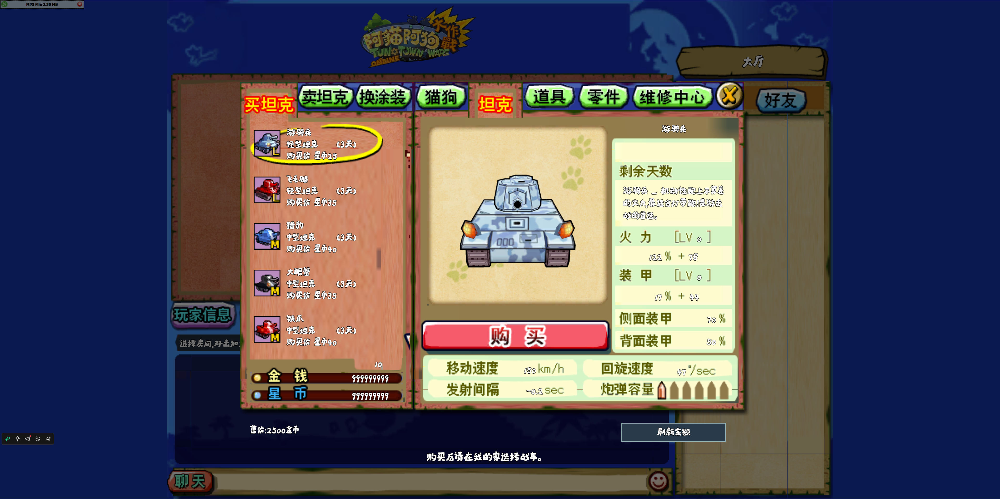
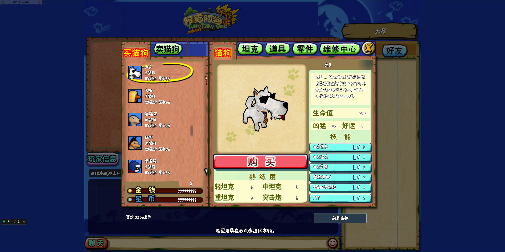
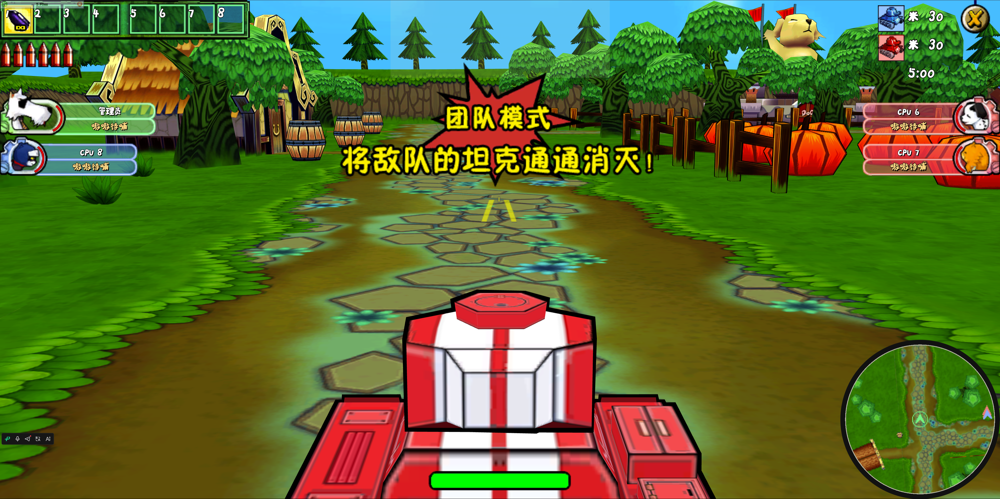
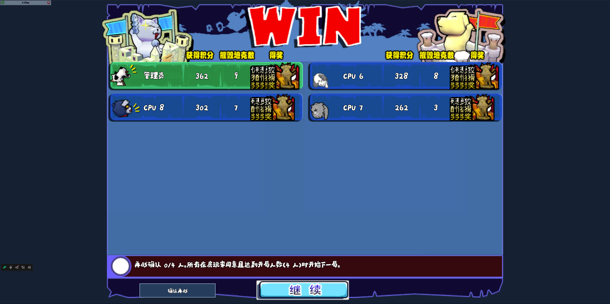

# CDTank · 阿猫阿狗大作战复刻

当前版本：**1.0.0** · [更新日志](CHANGELOG.md#100--2026-10-08)



**《阿猫阿狗大作战 Online》的非官方 Web 复刻项目。** 使用原 Windows 客户端的资源、数据表和程序行为作为依据，以 Babylon.js、React 和 TypeScript 重建浏览器客户端，以 Node.js 和 TSRPC 实现联机服务端，让猫狗战车重新驶回木桶镇。

原作由上海软星制作、大宇资讯发行，是《阿猫阿狗》系列的休闲坦克射击网游，2006 年推出。玩家操控猫狗角色驾驶战车，在木桶镇的街头巷尾交战，画面沿用系列的卡通渲染风格。背景资料见[原作介绍](docs/game-background.md)。



*原作参考画面，来源为巴哈姆特作品资料页；图片出处和权利说明见[素材来源](docs/assets/README.md)。*

当前工作区使用原版 UI 和图片资源，保留现有 3D 模型贴图与涂鸦手绘小地图。原始资产发布命令见[运行美术资源](docs/original-assets.md)。

## 当前内容

- **联机对战**：创建和加入房间、密码房、换队、准备、战斗、结算及再战。
- **五种模式**：团队、占领、擒王、混战、破坏；载入原表中的 26 个模式／地图组合。
- **战车与场景**：21 种原版战车，恢复地图、部件、宠物、动画、界面图块、音乐和音效。
- **账户与角色**：注册登录、我的家、库存与装备、商城及社交功能，保存角色成长、称号与账户资料。
- **成长与交易**：战车火力／装甲改造、宠物技能学习确认、装饰部件购买、贵重品数量出售与维修计时。
- **玩家与社交**：公开资料、精确昵称查找、家族聊天，以及 GM 问题提交和回复收件箱；家族归属与人工回复由本机运营者管理。
- **战斗统计**：记录每局射击、命中、伤害和连杀等统计，结算九项战斗奖章，累计战绩与实际消费保存到 SQLite。
- **CPU 对手**：可在等待房间添加 CPU，通过同一套战斗输入和规则参与对局。
- **资源工具**：独立资源查看器，以及 CPK、MV3、POL、CVD 和数据表的提取与转换工具。
- **显示与加载**：窗口／全屏、画质和卡通描边设置，图片缓存与加载恢复，以及离线高清素材和模型预览工具。

项目仍在持续还原中。完整原版规则、全部技能道具、界面表现和高清多人性能的完成情况，以[任务清单](docs/recovery/tasklist.md)和各专题证据为准。

## 项目截图

### 战车商城



### 猫狗商城



### 团队模式



### 战斗结算



## 本地运行

需要 **Node.js 24.16 或更高版本**和支持 **WebGPU** 的浏览器。客户端通过 HTTPS 或 localhost 访问。以下命令在仓库根目录执行。

```bash
npm ci
```

已有 `apps/web/public/` 和 `apps/server/resources/` 时可直接启动。美术目录只保留 `art/original/` 与 `art/hd/`：UI 使用原版低清单图，模型贴图和 minimap 使用高清图片。发布本地美术资源运行 `npm run assets:original`；目录与发布方式见[运行美术资源](docs/original-assets.md)。

全新环境需安装包含模型、独立贴图、音频、UI、字体与数据表的单图资源包：

```bash
npm run assets:install -- --archive /path/to/cdtank-assets.tar.xz
```

安装资源包需要支持 `.tar.xz` 的 `tar`；Linux 需安装 `tar` 和 `xz-utils`。资源解压到 `apps/web/public/` 和 `apps/server/resources/`。GitHub v1.0.0 已发布资源包仍使用精灵图，需要更新为单图资源包后才能用于当前版本；安装器会在解压前识别该格式。

### 2. 启动服务端和网页

在两个终端中分别运行：

```bash
# 终端一：联机服务端，默认端口 3001
npm run dev:server
```

```bash
# 终端二：Web 客户端，默认端口 5173
npm run dev
```

打开 [http://localhost:5173](http://localhost:5173)，注册或登录，选择频道进入大厅，创建或加入房间，资源加载完成后点击准备。默认开局人数由地图原表决定；可在等待房间添加 CPU 补足人数，也可用多个浏览器窗口加入同一房间。

开场先显示模式介绍和战斗提示，提示结束后开始计时并开放操作。结算画面保留最后的战场状态，可继续投票再战或返回大厅。

使用构建版本时，一个服务端进程即可提供网页、资源和联机连接：

```bash
npm run build:web
npm run build:server
PORT=40171 npm run start:server
```

本机打开 [http://localhost:40171/](http://localhost:40171/)，局域网及远程访问通过 HTTPS 反向代理连接该端口，以满足 WebGPU 的安全上下文要求。默认账户数据库仍为 `state/accounts.sqlite`，可通过 `ACCOUNT_DB_PATH` 指定已有存档。渲染实现见 [WebGPU 客户端渲染](docs/webgpu-rendering.md)。

| 默认按键 | 操作 |
| --- | --- |
| W / S | 前进 / 后退 |
| A / D | 车身左转 / 右转 |
| ← / → | 炮塔左转 / 右转 |
| 空格 | 开火 |
| 1–8 | 请求使用对应快捷槽 |

按键可在设置中调整。道具是否生效取决于账户库存和对应功能的还原状态。

### 3. 查看原版资源

```bash
npm run tools:assets:dev
```

打开 [http://localhost:5211](http://localhost:5211)，浏览模型、地图和动画。查看器与正式游戏共用转换资源，入口独立。

## 目录

```text
apps/
  web/src/              浏览器客户端：界面、渲染、音频与对局
  web/public/           正式静态资源：模型、贴图、音频、UI 与字体
  server/src/           联机服务端：房间、战斗、账户与社交
  server/resources/     正式服务端资源：数据表、场景与碰撞数据
  shared/               通信协议、共同契约和两端共用规则
docs/recovery/          还原任务、来源依据与专题说明
tools/recovery/         原客户端解析、导出和转换工具
tests/evidence/         原程序行为取证脚本和对应实现
recovery/               本地提取来源与中间结果，由 Git 忽略
state/                  本地账户存档，由 Git 忽略
scripts/                构建、资源重建、打包和账户备份脚本
deployment/             运行配置、反向代理与存档说明
tools/asset-viewer/     独立资源查看器
tests/                  现有资产、规则、联机和页面验收入口
```

运行资源单独发布到 GitHub Releases。原客户端 `CDTank/`、恢复工作目录 `recovery/`、正式运行资产目录和账户数据库、`node_modules/` 和 `dist/` 由 `.gitignore` 排除。

## 文档

| 内容 | 入口 |
| --- | --- |
| 版本变化 | [更新日志](CHANGELOG.md) |
| 原作背景与参考资料 | [原作介绍](docs/game-background.md) |
| 图片出处与权利归属 | [素材来源](docs/assets/README.md) |
| 开发命令、配置与项目范围 | [开发指南](docs/development.md) |
| 当前还原状态与专题导航 | [还原文档索引](docs/recovery/README.md) |
| 可选：从原客户端重新生成资源 | [资源重建](docs/recovery/reproducible-assets.md) |
| 生产部署与账户备份恢复 | [运行与账户存档](deployment/operations.md) |
| Forgejo CI/CD 与 Docker 部署 | [自动部署](deployment/forgejo.md) |
| GitHub 源码发布 | [发布说明](docs/github-publication.md) |

## 素材与许可

原作名称、美术、模型、音频、界面和其他游戏素材的权利归相应权利人所有。仓库中的原作参考图片用于介绍复刻对象，图片来源记录在[素材来源](docs/assets/README.md)。本项目与原作开发商、发行商没有官方关联。

Release 资源包包含从原客户端提取并转换的运行资源，以及运行所用的第三方字体，来源见[素材来源](docs/assets/README.md)。仓库尚未指定代码开源许可证，原作素材和第三方字体保留各自权利。
