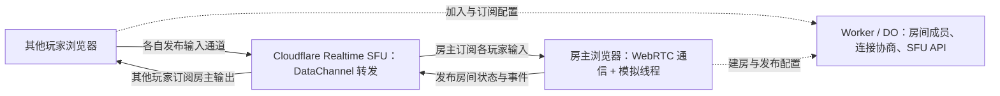
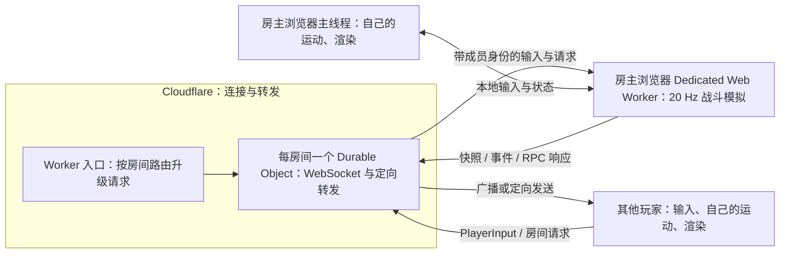

# Cloudflare 转发联机可行性研究

研究日期：2026-10-07。依据当前工作区源码、仓库已有性能记录和 Cloudflare 官方文档。

已完成账户开通和单独的链路采样，结果见 [SFU 开通与延迟测量](cloudflare-sfu-latency.md)：经 `192.168.10.1` 网关的小包消息 RTT 中位数 328.8 ms，并有秒级抖动。以下架构能力仍成立，但当前实测路径不适合直接投入游戏迁移。

## 结论

**可以实现。以低延迟和免费额度为目标，优先考虑“Cloudflare Realtime SFU DataChannels 转发 + Worker/DO 仅协调连接 + 房主负责战斗模拟”。** 也可以采用 Worker + 每房间一个 DO 转发 WebSocket。两种方案中，位置处理、碰撞、弹丸、伤害、CPU、道具、模式规则和结算都在房主设备上执行。方案排除 Cloudflare Tunnel。

房主可以是浏览器，也可以是运行现有 Node.js 服务的电脑。两者满足同一个转发约束，但改造量不同：

| 目标 | 方案 | 判断 |
| --- | --- | --- |
| 云端只转发，优先低延迟与多人扇出 | 浏览器房主计算，Realtime SFU DataChannels 转发，Worker/DO 只做连接协调 | 当前首选，有共享免费流量额度，需要改造为 WebRTC |
| 尽量复用现有 WebSocket 通信方式 | 浏览器房主在 Dedicated Web Worker 中运行模拟，Worker + DO 转发 | 可行，需要抽离模拟与改造会话路由 |
| 保留 Node.js 计算，又明确要求自建 Worker 房间中继 | Node.js 主机主动连接 Worker + DO，玩家消息定向转发到主机 | 可行，需要处理多个玩家会话的复用与 RPC 回包路由 |
| Cloudflare 只做信令，游戏数据优先直接传输 | WebRTC 房主模式，必要时使用独立 TURN 产品 | 可行，但游戏数据通常不经过 Worker，不作为本次主方案 |

当前代码不能只把 `/game` 地址改成 Worker 地址便完成迁移。它仍需要一个执行现有服务端职责的房间主机。无需让所有客户端重复计算完整世界，也无需先改成确定性锁步。

## 低延迟与免费方案选择

Cloudflare 当前的 Realtime SFU **支持任意应用数据的 DataChannel**，可传递游戏状态、输入、聊天和控制指令；一个发布者的消息可分发到多个订阅者，不局限于音视频。[S19] 使用这个产品不需要 Tunnel，也不需要云端计算游戏世界。

| 传输方案 | 免费范围 | 游戏消息路径 | 主要取舍 |
| --- | --- | --- | --- |
| WebRTC 直连 + Cloudflare STUN | STUN 免费且不限量；直连数据不经过 Cloudflare | 玩家 ↔ 房主 | 直连成功时可避开中继绕路；房主向每个玩家单独发送，且部分 NAT/防火墙需要 TURN |
| Cloudflare Realtime TURN | 与 SFU 共享每月前 1,000 GB 出站免费 | 玩家 ↔ TURN ↔ 房主 | WebRTC 点对点中继，支持 UDP 和网络受限时的 TCP/TLS 接入；仍由房主逐个发送 |
| Cloudflare Realtime SFU DataChannels | 与 TURN 共享每月前 1,000 GB 出站免费 | 玩家 ↔ SFU ↔ 房主；房主发布一次，SFU 分发 | 适合多人房间，减少房主快照上行与复制；需要发布/订阅配置 |
| Worker + DO WebSocket | DO 有每日请求与 duration 免费额度 | 玩家 ↔ 固定房间 DO ↔ 房主 | 复用现有协议较直接；不提供 WebRTC 的消息可靠性选择 |

免费范围与 TURN 地理位置来源：[S14]。上述 WebRTC 传输支持游戏二进制消息，是端点协议改造，不要求把画面编码为视频。[S19]

### 适合本游戏的 SFU 拓扑

每个玩家发布自己的输入通道，只有房主订阅这些输入；房主发布状态通道，其他玩家订阅。**不能让所有玩家都通过同一通道的 `canReply` 回传输入**，因为每个发布通道最多只允许一名订阅者持有回复权限。[S19][S21]

Worker/DO 只参与建房、加入、成员变化和连接恢复等低频操作，战斗数据经过 SFU。SFU API 的每 session 50 requests/s 限制用于配置 API，不要求每一帧游戏更新调用 HTTP API。[S20][S21] 连接控制可以使用 Workers Free 与 SQLite-backed DO 免费额度；其计费仍独立于 Realtime 的免费流量。[S4][S9][S14]

房主浏览器中的 WebRTC 连接与模拟线程通过本地消息交接数据。现有模拟抽离、账户存档和房主离线处理仍然需要完成；更换传输产品不会移除这些职责。

### 为什么适合降低延迟

游戏流量离开固定房间 DO 的 WebSocket 路径，改由 Realtime 的 WebRTC 传输网络转发。SFU 支持可靠有序消息，也支持 `ordered: false, maxRetransmits: 0`，可以让可替换的旧状态丢弃，避免为其重传和等待。[S19] Cloudflare 管理 SFU 基础设施，应用不必选定一个 SFU 部署地区。[S20]

可替换的状态快照适合无序、不重传通道；准备、道具使用、结算和 RPC 等离散操作应保留可靠传递。当前 `PlayerInput` 同时包含移动与 `useItem`，不能整包改为允许丢失后仍假定每次道具操作成功送达。当前客户端还依赖快照先于事件：首版可继续使用可靠有序通道保持这个顺序；分开状态和事件通道时，必须明确回合/tick 的对应关系，跨通道没有原 WebSocket 的顺序保证。

这一结构提供降低延迟的手段；它不是任意网络下都比 Worker 更快的 RTT 承诺。WebRTC 优先使用可用的 UDP 路径，受限网络的 TCP/TLS 回退仍会有队头阻塞。Cloudflare 官方也指出，双方使用其 TURN 后更可预测的改善是丢包和可靠性，实际延迟改善取决于地理位置。[S14]

### 免费额度对十二人房间意味着什么

沿用本文估算：十二人包含房主、20 Hz、快照 8 KiB、输入 100 B。SFU 每小时快照出站约 6.49 GB，加上发给房主的输入后约 **6.57 GB/房间小时**。每月 1,000 GB 相当于约 **152 个满员房间小时**，未包括事件、协议开销和该账户其他 Realtime 用量。

SFU 下房主快照上行约 160 KiB/s。P2P/TURN 房主对十一名玩家逐个发送同样快照，上行约 1.72 MiB/s，约为十一倍；直连成功的部分不会消耗 Realtime 中继额度。

SFU 与 TURN 的 1,000 GB 是同一个月额度，不是各有 1,000 GB。超出为 `$0.05/GB`；接入 SFU 时经过 Cloudflare TURN 的内部链路不重复收取 TURN 费用。[S14] 该产品属于免费额度模式，不能承诺长期不限量免费。

## 当前游戏的计算与同步职责

现有客户端已经计算手动移动并上报姿态，服务端接受姿态时处理玩家间占位与垂直状态；其余战斗规则仍由 Node.js 服务端统一执行。

| 职责 | 当前实现 | 浏览器房主方案中的归属 |
| --- | --- | --- |
| 按键与手动运动、地图导航、车身和炮塔姿态 | [`battle-input.ts`](../apps/web/src/match/battle-input.ts)、[`local-tank-motion.ts`](../apps/web/src/match/local-tank-motion.ts) | 各玩家客户端继续执行 |
| 输入序号、回合与生命轮次判断、玩家间占位 | [`accept-input.ts`](../apps/server/src/battle/accept-input.ts)、[`client-movement.ts`](../apps/server/src/battle/client-movement.ts) | 房主模拟线程 |
| 弹丸、命中、血量、复活、CPU、宠物、道具与场景破坏 | [`World.simulateRoom`](../apps/server/src/world.ts)、[`actors.ts`](../apps/server/src/battle/actors.ts)、[`projectiles.ts`](../apps/server/src/battle/projectiles.ts) | 房主模拟线程 |
| 准备、加载、开局、模式目标、计分与结束 | [`world.ts`](../apps/server/src/world.ts)、[`rooms/`](../apps/server/src/rooms)、[`modes/`](../apps/server/src/modes) | 房主；中继只维护网络成员 |
| 房间快照和事件生成 | [`snapshot.ts`](../apps/server/src/rooms/snapshot.ts)、[`runtime/tick.ts`](../apps/server/src/runtime/tick.ts) | 房主生成，所选 DO 或 SFU 转发 |
| 画面、音频、资源展示 | `apps/web/src/render/`、`assets/`、`audio/` | 各玩家浏览器主线程 |
| 注册、登录、拥有物、商城、交易、奖励与历史 | [`account-store.ts`](../apps/server/src/account-store.ts)、[`settlement/history.ts`](../apps/server/src/settlement/history.ts) | 保留独立账户服务，或明确改为本地存档 |

具体同步依据：

- [`runtime/config.ts`](../apps/server/src/runtime/config.ts) 默认 `TICK_RATE = 20`，每次模拟的固定步长为 50 ms。
- [`BattleInput.start`](../apps/web/src/match/battle-input.ts) 每 50 ms 刷新输入，按键变化和道具操作额外立即发送。
- [`battle.ts`](../apps/web/src/match/battle.ts) 给 `PlayerInput` 附上 `localMotion.reportedPose`；[`MsgPlayerInput`](../apps/shared/protocols/MsgPlayerInput.ts) 已包含位置、朝向、回合、生命轮次和序号。
- [`startWorldTicks`](../apps/server/src/runtime/tick.ts) 每 tick 先广播快照，再广播事件。迁移后应保留这个顺序。
- [`RoomFeed`](../apps/web/src/match/room-feed.ts) 已按房间、回合和 tick 接受快照。客户端展示逻辑与既有协议类型有较大复用空间。

因此，现有“玩家计算自己的手动移动”是有利基础，但仅广播各人的位置无法产生统一的弹丸命中、CPU 行为或结算结果。

## Worker + DO WebSocket 结构

这里的 **Dedicated Web Worker 是房主浏览器里的计算线程**，与 Cloudflare Worker 是两个不同运行环境。它隔离渲染与模拟，通过 `postMessage` 交换本地数据，也可以自行建立 WebSocket。[B1]

### Cloudflare 端负责什么

Worker 根据 `roomId` 找到对应 DO，并把 WebSocket 升级请求交给它。同一房间的房主和其他玩家都建立到该 DO 的入站 WSS 连接。之后的数据帧由 DO 处理和转发，不需要每条消息再次经过一个独立的入口 Worker 处理器。

DO 仅保留房间编号、连接身份、房主连接、成员和重连所需的少量元数据：

1. 玩家输入与房间请求只转给房主。
2. 房主发出的快照和公共事件发给房间成员；RPC 响应、私聊等按指定成员发送。
3. 房主负责决定队伍聊天接收者等游戏语义，DO 只执行接收者路由。
4. 使用 WebSocket Hibernation API；连接身份通过 WebSocket attachments 等机制恢复，避免依赖休眠后会消失的普通实例字段。
5. 只处理连接与路由，不创建 `World`，不启动游戏 tick，不保存每帧战斗状态。

Cloudflare 官方明确指出，聊天室或多人游戏等多连接应用需要一个协调点，DO 能承担这项职责。[S1][S2] 普通 Worker 的全局变量不能作为所有玩家都能可靠访问的房间连接表。[S3]

按房间分配 DO，使不同房间独立处理流量。初版可使用房间邀请码加入；如果继续提供跨房间列表与频道，需要单独维护少量房间目录元数据，不能把各 DO 的局部内存当作全局大厅。

### 房主负责什么

房主持有该局唯一完整模拟状态，执行现有 `World.step(50)` 和输入处理，产生 `RoomSnapshot`、`RoomEvent` 及房间 RPC 响应。房主自己的输入可以在本机直接交给模拟线程，自己的画面消费同一套模拟结果。

保留当前固定步长、回合与生命轮次、输入序号和快照先于事件的处理方式。现有 `serverTime` 在新模式中代表房主模拟时钟，其他客户端沿用时间偏移同步；中继不决定战斗时间。

随机暴击、掉落、出生点和 CPU 行为由同一个房主计算后发布结果。当前代码使用 `Math.random`，例如 [`world.ts`](../apps/server/src/world.ts) 和 [`settlement/history.ts`](../apps/server/src/settlement/history.ts)。让所有玩家仅凭输入各自模拟一致结果，会另外涉及随机数、时钟和执行顺序的确定性改造，收益不足以作为此次迁移的起点。

## 必须改造的边界

### 1. 把模拟从 Node.js 环境中抽出来

核心战斗代码已经是 TypeScript，但其依赖链尚不能直接导入浏览器线程：

| 现有依赖 | 源码位置 | 迁移处理 |
| --- | --- | --- |
| 模块加载时同步读取原数据表、场景和地图 | [`config.ts`](../apps/server/src/config.ts)、[`battlefield.ts`](../apps/server/src/battlefield.ts)、[`scene-objects.ts`](../apps/server/src/scene-objects.ts) | 将资源加载与模拟分开，浏览器异步取得数据后创建房间模拟 |
| 文件路径与 `process.env` | [`runtime/content-paths.ts`](../apps/server/src/runtime/content-paths.ts) | 在初始化时传入资源与配置 |
| SQLite 账户存取 | [`account-store.ts`](../apps/server/src/account-store.ts) 使用 `node:sqlite` | 留在账户服务或独立本地存档层，不纳入模拟线程 |
| Node 专用计时、UUID 和部分房间凭据类型 | [`battle/cpu/navigation.ts`](../apps/server/src/battle/cpu/navigation.ts)、[`battle/items/ground-items.ts`](../apps/server/src/battle/items/ground-items.ts)、[`rooms/state.ts`](../apps/server/src/rooms/state.ts) | 使用浏览器对应 API，分离网络/凭据元数据与战斗状态 |
| 直接扣除账户道具、授予拥有物与提交奖励 | [`index.ts`](../apps/server/src/index.ts) 创建 `World` 时注入的回调 | 明确模拟内库存和长期账户库存的交接方式 |

优先抽出无渲染、无磁盘和数据库依赖的模拟模块，由 Node.js 主机和浏览器房主共用，保持现有战斗规则。

房主还需要完整的弹道、地形、场景碰撞和动态对象数据。现有 [`ClientBattlefield`](../apps/web/src/match/client-battlefield.ts) 只加载 `/movement/<map>.json` 中的导航与占位数据；这不能替代服务端 [`Battlefield`](../apps/server/src/battlefield.ts) 使用的碰撞网格和场景几何。浏览器房主应按当前地图加载模拟资源。

### 2. 分开账户通信与对战通信

[`GameConnection`](../apps/web/src/network/game-connection.ts) 当前用同一条 TSRPC WebSocket 处理账户与房间请求，连接后立即调用 `Account`。普通房间中继不能直接完成这套初始化。

浏览器房主模式需要分别建立账户连接和房间连接，或明确使用本地身份/存档。`PlayerInput`、快照和事件的类型可以继续复用；`Ready`、`Loaded`、`Cpu`、`Autopilot`、换队和再战等请求则要路由到房主执行。

TSRPC 既有单向消息，也有带请求编号的 RPC。多个玩家连接复用到一个房主连接时，需要携带源成员与目标成员，响应返回原请求者。把所有 TSRPC 二进制包直接广播会混淆请求与响应。中继只解析路由信封，游戏 payload 由端点处理。

### 3. 明确长期账户功能的去向

当前完整游戏包含注册、拥有物、商城、交易、道具消耗、奖励与战绩事务；[`accountMatchHistory`](../apps/server/src/settlement/history.ts) 将历史和奖励一并持久化。纯转发节点无法自然承担这些职责。

- **保留现有账户体验：** 继续运行独立账户服务；浏览器房主获得开局所需角色与库存数据，结束后提交结果。该服务仍需处理存档业务，并明确接受房主结果的信任范围。
- **云端严格只有转发：** 采用本地存档和熟人房间结果。浏览器持久化可以保存个人进度，但与现有统一商城、交易、跨设备账户和权威奖励不是同一种产品行为。
- **保留全部功能与可信主机：** 让 Node.js 主机继续运行模拟和 SQLite，通过自建中继提供联机入口；选择 SFU 时主机也需要 WebRTC 端点实现。

数据库换成 D1 不会自动完成上述拆分。如果另外允许云端处理账户业务，可以单独评估账户服务迁移；这不属于“Worker 只转发”方案本身。

### 4. 延续断线重入，首版不做房主迁移

现有 [`RoomReconnections`](../apps/server/src/rooms/reconnection.ts) 保留断线玩家，并把新连接重新绑定到原参与者。浏览器房主可继续保留这项能力；DO 恢复的是连接身份，房主恢复的是游戏参与者，两者需要对应。

建议首版在房主真正离线或模拟停止后结束房间，玩家重新建房。当前 [`MsgRoomSnapshot`](../apps/shared/protocols/MsgRoomSnapshot.ts) 是展示投影，不是完整模拟检查点。例如 [`RoomState.airstrikes`](../apps/server/src/rooms/state.ts) 中尚未落地的空袭不会进入快照，CPU 控制器等内部状态也不能仅靠公开快照重建。无缝接替房主需要另外设计完整状态导出与恢复。

## 性能与流量判断

### 可以复用的现有证据

| 既有记录 | 场景 | World 单 tick p95 / 峰值 | 最大快照间隔 |
| --- | --- | --- | --- |
| [十二账户连接扇出](../docs/recovery/complex-map-human-fanout.md) | map20、破坏模式、12 个真实账户连接、普通 Autopilot、默认弹药，观察 60.249 秒 | 15.06 / 36.04 ms | 服务端 52 ms，接收墙钟 95 ms |
| [十二参与者复杂地图](../docs/recovery/complex-map-max-players.md) | map20、2 个账户连接 + 10 个 CPU，编译 Node.js 服务，观察 60 秒 | 13.79 / 30.04 ms | 服务端 54 ms，接收墙钟 74 ms |

这说明当前单房间模拟在已有 Node.js 场景下能落在 50 ms 节拍内，可作为抽离模拟的基础。浏览器房主的硬件、资源内存、渲染竞争和网络是另一个验收范围。

### 以十二人、20 Hz 估算转发量

以下是容量估算：总人数 `N = 12`，包含房主；其余 11 人各发 20 条输入/秒，房主发 20 个房间快照/秒，房主本人的输入在本机处理。假设一个编码后的输入为 **100 B**、一个完整房间快照为 **8 KiB**。这两个包大小是估算参数，尚未测量本游戏实际编码结果。

| 指标 | 计算 | 估算值 |
| --- | --- | --- |
| DO 入站消息 | `11 × 20 + 20` | 240 条/秒 |
| DO 输出输入消息到房主 | `11 × 20` | 220 条/秒 |
| DO 输出快照到其他玩家 | `11 × 20` | 220 条/秒 |
| 房主快照上行 | `20 × 8192` | 160 KiB/s，约 1.31 Mbit/s |
| 每个其他玩家的快照下行 | 同上 | 160 KiB/s |
| DO 全部快照下行 | `11 × 20 × 8192` | 1.72 MiB/s，约 6.49 GB/小时 |
| 房主输入下行 | `11 × 20 × 100` | 约 21.5 KiB/s |

表中尚未加入事件、心跳、额外即时输入、路由信封和协议开销。快照大小直接决定带宽：如果实际包是 32 KiB，快照流量为表中四倍。

房主每 tick 只上传一次完整房间快照，由 DO 扇出，房主上行不会乘以其他玩家人数。输入只送房主；无需给所有玩家广播所有人的输入。

现有 [`playerSnapshot`](../apps/server/src/rooms/snapshot.ts) 在快照中重复携带技能、外观、运动参数和弹药槽等数据。先复用完整协议完成迁移；实际包大小或排队延迟成为问题时，再把低频数据与动态状态分开。关键事件与 RPC 响应应保持可靠传递，发送端尚未发出的过时全量快照可以合并为最新快照，避免慢连接不断积压旧画面。

### 延迟与地理位置

远端玩家的动作确认路径是：

`玩家 → 房间 DO → 房主 → 等待模拟 tick → 房间 DO → 玩家`

正常调度时，tick 等待本身最多接近 50 ms，网络往返和模拟耗时另外计算。自身移动仍可继续即时本地计算；开火结果、伤害、场景破坏和模式状态依赖房主回传。

DO 通常在首次请求附近创建，同一对象是固定协调点；`locationHint` 为尽力安排。[S6] 每个玩家接入附近的 Cloudflare 边缘节点，并不意味着房间状态也同时位于每个人附近。选择靠近房主和主要玩家的房间位置有帮助，跨地区路线仍需实际记录。

## Worker + DO 的限制与计费

### 与本方案直接相关的限制

| 项目 | 官方当前说明 | 对本方案的影响 |
| --- | --- | --- |
| 房间协调 | DO 提供同一对象的状态与连接协调 | 一房间一 DO，普通 Worker 全局变量不能代替 |
| 连接数量 | Hibernation API 单 DO 最多 32,768 个 WebSocket，实际受工作负载限制 | 十二人连接数远低于 API 上限；上限不是吞吐承诺 |
| 收到的 WebSocket 消息 | 最大 32 MiB | 游戏状态应保持小包；地图和美术资源使用 HTTP 获取 |
| 内存 | Worker isolate 128 MB，可由同一 isolate 中的多个 DO 共享 | DO 只保留连接与元数据，避免加载完整地图或战斗资源 |
| 处理能力 | DO 单线程，官方给出单对象约 1,000 requests/s 的软限制 | 房间拆分可分散负载；20:1 计费折算不会提高实际处理能力 |
| 免费计划 | 可以使用 SQLite-backed DO | 创建该类 DO 不要求把游戏数据逐帧写入 SQLite |
| 连接生命周期 | 部署及基础设施重启可能断开 WebSocket | 客户端需要自动重连，不能把 WSS 当作永久不断开的连接 |

来源：[S1][S2][S4][S5][S7][S8][S17]。这里的 240 条/秒只是上节假设下的入站量，不是已测得的 DO 承载成绩。

### 计费口径

根据当前官方价格：[S4][S9]

- Worker WebSocket 初始升级请求计请求，后续 WebSocket 消息不另计 Worker 请求；Workers 没有额外 egress/带宽费用。
- DO 建立连接计一次请求；**入站消息按 20:1 折算计费请求**，出站 WebSocket 消息与协议级 ping 不计请求费。
- DO 免费额度为每天 100,000 请求和 13,000 GB-s；付费计划每月含 1,000,000 请求、400,000 GB-s，超出单价分别为 `$0.15 / 百万请求`、`$12.50 / 百万 GB-s`。
- Workers Paid 最低 `$5/月`。额度按账户及相关产品汇总使用，不能对每间房重复领取。
- DO duration 按每对象分配的 128 MB 计算。依官方示例换算，整小时均计费为 `3600 × 0.128 = 460.8 GB-s`。
- DO 超额月用量按计费单位向上取整后应用单价，不能把每房间小时的线性估算直接当作账单。

**Hibernation 不仅用于空房。** 官方现行规则明确：对象空闲且符合休眠条件时，即使尚未真正从内存移除，也不计 duration。因此，高频但很短的转发处理之间仍可能省掉空闲计费；240 条/秒不能直接推导出整局持续计费。[S4]

使用 Hibernation API，让处理器快速转发后结束；在 DO 中使用普通 `ws.accept()`、持续定时器或未完成的异步工作会影响休眠资格。应用层自动心跳响应还可以使用 `setWebSocketAutoResponse`，但它与现有 TSRPC 自定义心跳能否直接对接，要在通信实现时确定。[S2][S4]

按上节假设，一房间小时有 `240 × 3600 / 20 = 43,200` 个消息折算请求。免费请求额度约支持 **2.31 个此类房间小时/天**，实际要扣除连接、事件和其他业务的消耗。

一个仅用于说明数量级的付费例子：十二人房间每天持续运行 24 小时，共 30 天，即 720 房间小时：

| 项目 | 假设用量 | 该例计算 |
| --- | --- | --- |
| DO 消息折算请求 | 31.104 百万/月 | 减去 1 百万，超额向上取为 31 百万，约 `$4.65` |
| DO duration | 即使整局均计费，也为 331,776 GB-s/月 | 低于 400,000 GB-s 月额度 |
| Workers Paid 最低费用 | `$5/月` | 与上项合计约 **`$9.65/月`** |

该例假设账户额度由这个方案使用，未加入事件、重连、目录请求、存储和其他产品费用。上线预算应代入真实入站消息数及 duration，而不是以此价格承诺十二人服务成本。

## 其他路径的取舍

### 现有 Node.js 主机 + 中继

Node.js 主机也可主动连接房间 DO，继续运行原模拟和 SQLite，但必须另外处理多玩家逻辑会话；它与透明代理每条原有 WebSocket 不是同一实现。通过 SFU 则需要给主机增加 WebRTC 发布与订阅能力。

### WebRTC + 信令中继

Cloudflare Worker + DO 可以转发房主与其他玩家的信令，让 WebRTC DataChannel 承载游戏消息。直连失败时需要 TURN；普通 Worker 不能直接充当传统 TURN 服务，其 TCP socket API 仅支持出站连接，Node 兼容的 `node:dgram` 也是无功能 stub。[S12][S13]

Cloudflare Realtime TURN 是独立产品，有与 SFU 共享的流量价格。[S14] 如果目标是优先直连、减少 Cloudflare 转发流量，可选择这条路径；如果目标是多人扇出和控制房主上行，则选择 SFU DataChannels。

网页、模型、贴图、音频和模拟数据都应通过静态 HTTP/CDN 提供，可选 Workers Static Assets 或 R2。[S15][S16] [`README`](../README.md) 记录安装后运行资源约 933 MB，不能把这理解为每个房主必须同时载入全部资源，也不应通过对战 WebSocket 发送资源包。

## 建议实施顺序

1. **先抽离单房间模拟。** 分离文件加载、SQLite、凭据与战斗逻辑；保留 Node.js 使用相同模拟模块，浏览器仅按当前地图加载计算数据。
2. **完成浏览器房主与一名远端玩家。** 用 Worker/DO 协调房间，Realtime SFU DataChannels 转发战斗数据；从现有手动运动、默认弹药、命中、结束和再战形成完整闭环。
3. **接入已有房间和完整战斗功能。** 准备、加载、换队、CPU、道具、场景变化、模式规则、私聊和断线重入继续由房主处理。
4. **落实存档选择。** 若要求完整账户业务，保留独立账户服务并接通库存与结算；若严格没有其他云端业务，明确本地存档与熟人房间的产品行为。
5. **在允许实测时评估目标人数。** 从小房间扩展到原地图人数上限，按真实包大小决定是否拆分静态数据和动态快照；首版房主离线结束房间。

后续实测需要解决的具体判断：

| 需发现的失败 | 记录内容 | 若发生，如何改变实现 |
| --- | --- | --- |
| 房主计算赶不上 50 ms tick 或影响渲染 | 浏览器模拟 p95/峰值、完整 tick 间隔、渲染帧时间、资源内存 | 定位真实模拟热点、按图加载数据；必要时选择 Node.js 房主或降低该模式人数 |
| 转发后操作确认延迟过大 | 玩家→DO→房主及回程时间、事件确认时间、收到快照间隔 | 调整房间位置/房主选择；若路线仍不适合，再评估 WebRTC |
| 带宽或旧快照排队影响可玩性 | 实际编码输入/快照/事件大小、发送与接收速率、队列延迟 | 拆分低频数据，合并尚未发送的过时快照 |
| 重连串错参与者，或重复执行道具/RPC | 连接身份、回合、生命轮次、序号和 RPC 响应对应关系 | 修正身份恢复与响应路由，保留已有输入去重语义 |
| 实际成本偏离估算 | DO 原始消息数、折算请求、duration 和月用量 | 按真实负载重算预算，移除妨碍休眠的中继工作 |

## 限制

- 本次是源码和官方能力研究，复用已有性能证据；没有运行测试、浏览器验收、构建、类型检查或部署，也没有测量本游戏经过 Cloudflare 的实际延迟、包大小和浏览器房主性能。
- Dedicated Web Worker 将模拟移出渲染线程，但页面关闭、设备休眠和浏览器冻结/回收仍可能停止房主。后台计算不具备常驻服务器的可用性保证。[B1][B2]
- 房主拥有结果决定权，适合可信玩家联机。公开竞争排名和独立核验的长期经济需要额外权威来源；转发节点不会凭空获得这些能力。
- 首版结束离线房主的房间，无法无缝迁移。普通成员重连与房主接替是不同需求。
- DO 的全球入口不保证玩家到房主低延迟。Realtime TURN 不在 Cloudflare China Network 提供服务，大陆连接会使用境外节点；采用 SFU 也不能直接承诺大陆本地中继或低 RTT。不同地区、运营商和实际域名的可达性需要覆盖目标玩家网络。[S14]
- 官方公开 quickstart 的前提为 Cloudflare 账户，没有列出 Workers Paid；公开资料尚不足以确认所有账户开通 Realtime 都无需绑定支付方式。免费额度说明流量费用范围，不等于已经核实开户无需信用卡。[S22]
- 费用采用研究日官方规则，示例含明确负载假设；套餐共享额度、实际事件量、duration 和后续价格变化会影响结果。

## 官方来源

- [S1：Workers WebSockets API](https://developers.cloudflare.com/workers/runtime-apis/websockets/)：多人连接协调、DO、消息大小和重连说明。
- [S2：Durable Objects WebSocket best practices](https://developers.cloudflare.com/durable-objects/best-practices/websockets/)：Hibernation、连接恢复与应用层自动响应。
- [S3：Workers isolate 与全局状态](https://developers.cloudflare.com/workers/reference/how-workers-works/)：运行实例与状态持久性边界。
- [S4：Durable Objects pricing](https://developers.cloudflare.com/durable-objects/platform/pricing/)：免费/付费额度、20:1、出站消息、duration 与取整规则。[研究时固定版本的计费正文](https://github.com/cloudflare/cloudflare-docs/blob/5fd34f5288bbc59e2afb1a6792a0ccded2247baa/src/content/partials/durable-objects/durable-objects-pricing.mdx#L10-L40)。
- [S5：Durable Objects limits](https://developers.cloudflare.com/durable-objects/platform/limits/)：32 MiB 入站消息及对象限制。
- [S6：Durable Objects data location](https://developers.cloudflare.com/durable-objects/reference/data-location/)：首次创建位置与 location hints。
- [S7：Durable Object state API](https://developers.cloudflare.com/durable-objects/api/state/)：`acceptWebSocket`、`getWebSockets` 与连接上限。
- [S8：Durable Objects limits FAQ](https://developers.cloudflare.com/durable-objects/platform/limits/#frequently-asked-questions)：单对象单线程与吞吐软限制。
- [S9：Workers pricing](https://developers.cloudflare.com/workers/platform/pricing/)：最低费用、WebSocket 请求和 egress 口径。
- [S12：Workers TCP sockets](https://developers.cloudflare.com/workers/runtime-apis/tcp-sockets/)：仅支持出站 TCP。
- [S13：Workers Node.js compatibility](https://developers.cloudflare.com/workers/runtime-apis/nodejs/)：`node:dgram` 无功能 stub。
- [S14：Cloudflare Realtime pricing](https://developers.cloudflare.com/realtime/sfu/platform/pricing/) 与 [TURN FAQ](https://developers.cloudflare.com/realtime/turn/faq/)：独立 TURN 产品及价格。
- [S15：Workers Static Assets](https://developers.cloudflare.com/workers/static-assets/)：网页与静态资源托管。
- [S16：R2 public buckets](https://developers.cloudflare.com/r2/buckets/public-buckets/)：静态资源公开访问。
- [S17：Workers limits](https://developers.cloudflare.com/workers/platform/limits/)：isolate 内存限制。
- [S19：Realtime SFU DataChannels](https://developers.cloudflare.com/realtime/sfu/features/datachannels/)：任意应用消息、一对多、可靠性选择、`canReply` 和端点配置。[研究时固定版本](https://github.com/cloudflare/cloudflare-docs/blob/5fd34f5288bbc59e2afb1a6792a0ccded2247baa/src/content/docs/realtime/sfu/features/datachannels.mdx)。
- [S20：Realtime SFU application architecture](https://developers.cloudflare.com/realtime/sfu/concepts/architecture/)：数据与信令路径、Worker 后端、房间与发布订阅职责。
- [S21：Realtime SFU limits](https://developers.cloudflare.com/realtime/sfu/platform/limits/)：配置 API 速率、回复权限和恢复窗口。
- [S22：Realtime SFU get started](https://developers.cloudflare.com/realtime/sfu/get-started/)：开通步骤与公开 prerequisites。
- [B1：MDN — Using Web Workers](https://developer.mozilla.org/en-US/docs/Web/API/Web_Workers_API/Using_web_workers)：浏览器计算线程与线程通信。
- [B2：Chrome — Page Lifecycle API](https://developer.chrome.com/docs/web-platform/page-lifecycle-api)：页面冻结、任务暂停和回收。
