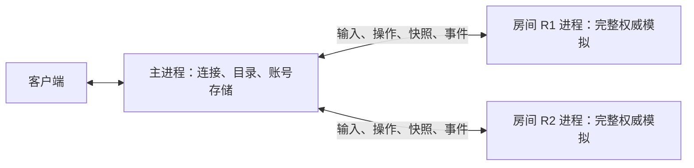

# 每个房间独立运行权威模拟

状态：采用。日期：2026-10-09。

## 背景

所有房间在同一个 Node 主线程上执行时，CPU 寻路、玩家移动和碰撞查询共用同一轮 tick 的时间。一个复杂房间会拖延其他房间的模拟和网络响应。

## 决策

房间创建时启动一个 Node 子进程，内部持有唯一的房间 `World`，从等待、加载、对战到重赛都使用同一个进程。房间进程独立按 `TICK_RATE` 推进模拟，默认 20 Hz。CPU 与托管决策、真人输入接受、玩家位置及炮塔更新、碰撞、射击、道具效果、目标和回合胜负均由所属房间执行。

主进程持有 WebSocket 连接、会话、房间目录和最近一次已发布快照，负责鉴权及消息转发。客户端协议保持现有格式；房间操作收到权威进程确认后再返回成功。角色 ID 由主进程分配，保持跨房间唯一的 `P数字` 格式。

## 通信与持久化

控制命令、回复和 tick 发布使用 Node IPC，并启用高级序列化以保留 `Map` 和二进制角色数据。每个房间保持发布顺序：同一 tick 的快照先于事件广播。发送积压时合并相邻待发送 tick 的快照，事件和命令回复保留顺序。

账号数据库仅由主进程的 `AccountStore` 打开。房间进程使用额外继承的两个管道提交同步账号请求：描述符 4 写请求，描述符 5 读回复；主进程以异步流读取请求，再执行既有同步事务。道具扣量、拾取、丢弃及奖励确认完成后，房间才应用对应战斗结果。同账号的库存变化通过主进程同步到其他房间，结算时冻结账号身份，断线清理不影响奖励归属。

普通移动输入回复不会额外生成完整房间快照；位置快照由房间 tick 发布。主进程的定时器只重试持久化回执，不驱动房间模拟。

## 生命周期与运行

最后一个真人离开后，房间关闭并结束所属进程。断线保留窗口沿用既有规则，恢复连接继续使用原角色和原房间进程。房间进程异常退出时，主进程拒绝其未完成命令、移除目录和会话，并向该房间客户端发送退出通知。主进程退出时结束其创建的所有房间进程。

`npm run dev:server` 通过继承 tsx 加载配置启动源码子进程；编译版入口启动同目录下的 `room-process.js`。无需新增监听端口或数据库连接。进程标题为 `cdtank-room-R数字`，可按 PID 分别观察房间资源占用。

## 限制

每个房间仍使用一个 JavaScript 主线程，多房间可以利用多核。单房间容量取决于该房间的地图和参战人数。独立进程增加了每房间的运行时及地图内存占用；账号事务和网络广播仍共享主进程。进程异常退出不会恢复正在进行的对局。

本改动仅进行静态代码走查，未运行测试、构建、类型检查或实机性能采样。既有性能记录不能作为进程拆分后的吞吐结果。
